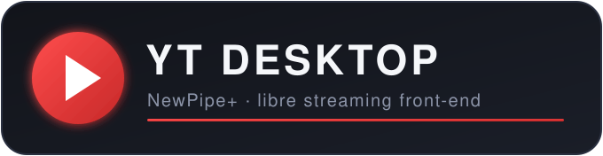
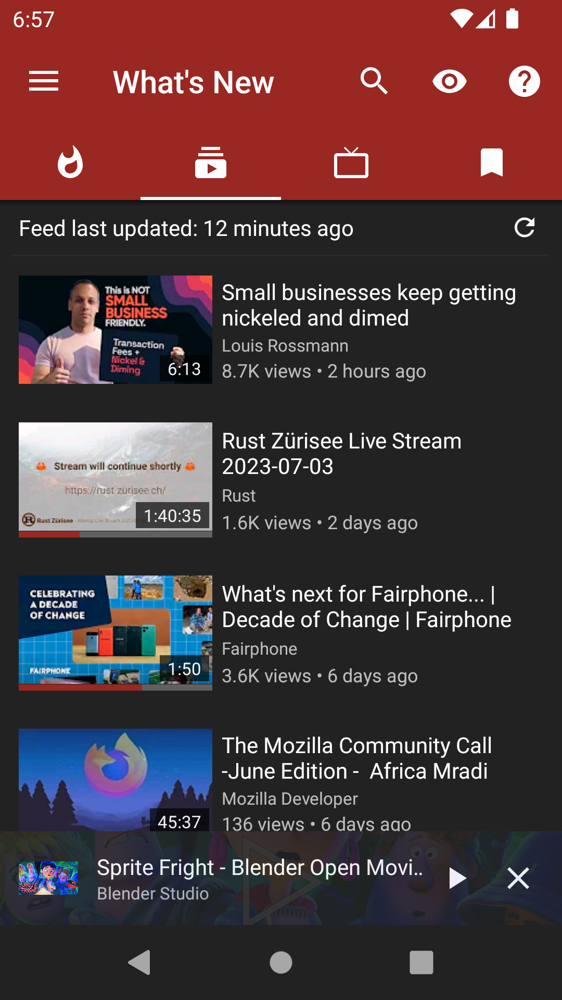
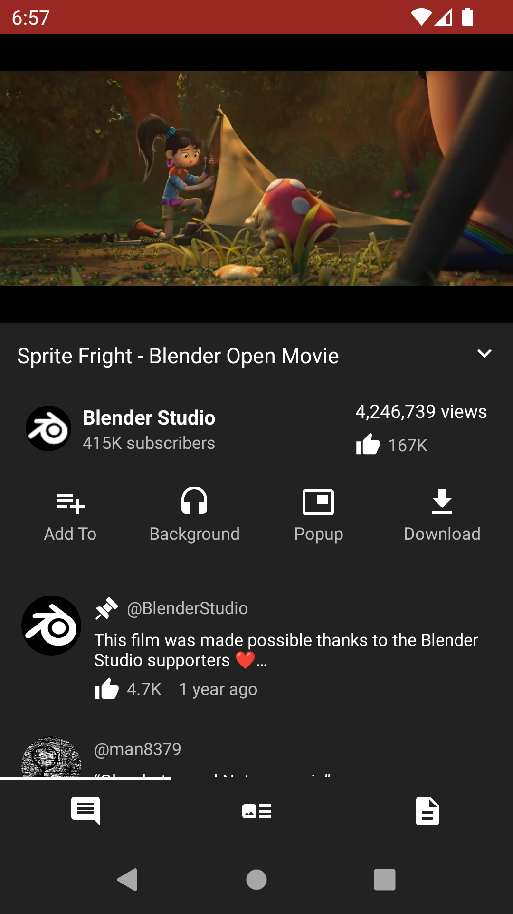
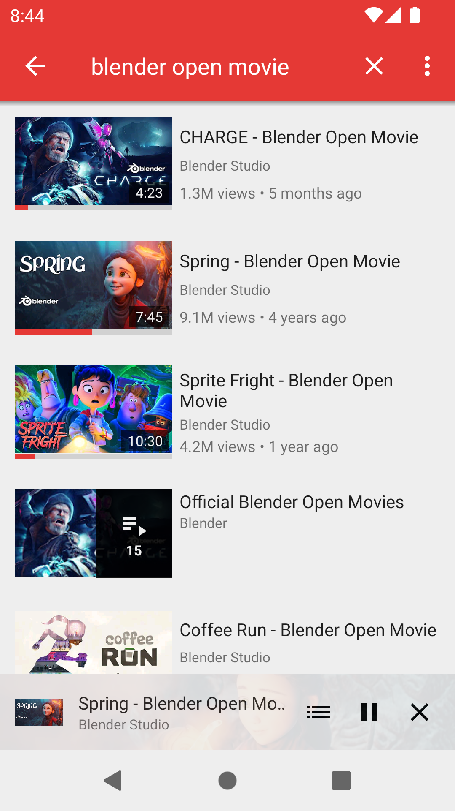
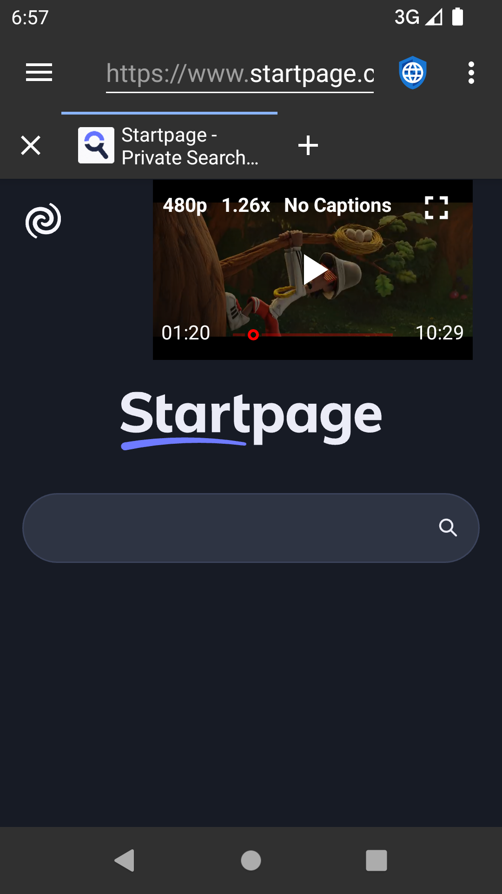
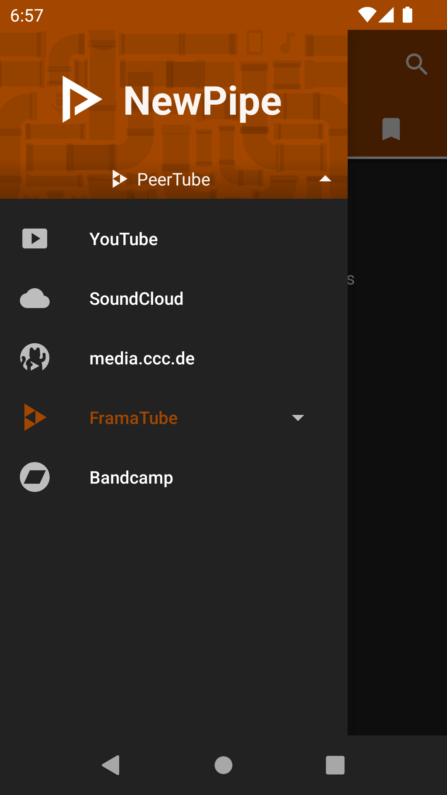
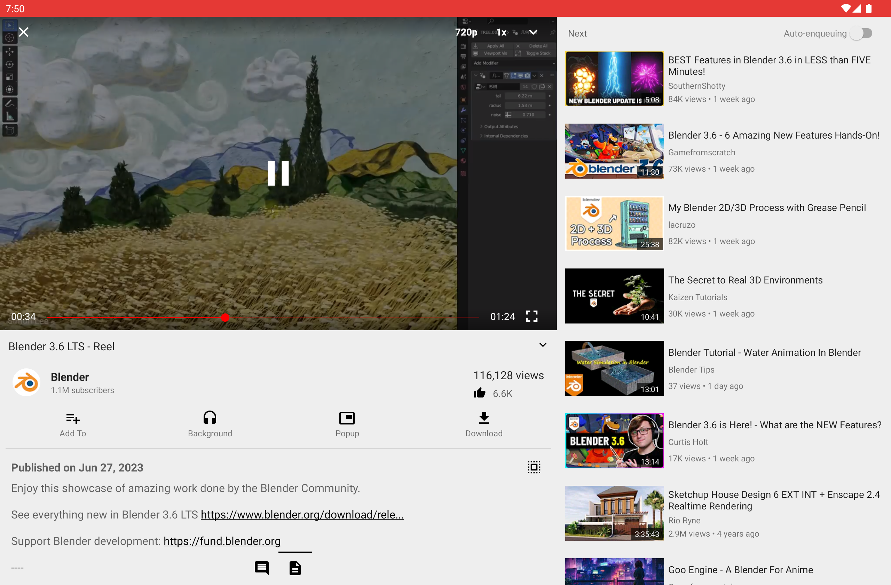
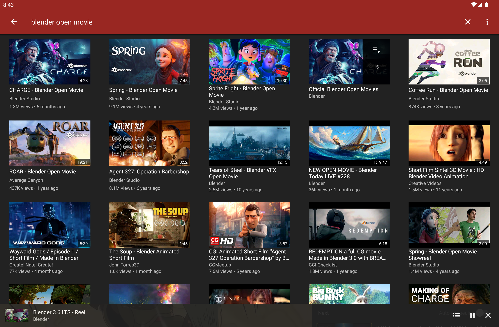

<p align="center">
  <a href="https://github.com/Tauseef666-ctrl/YT-DESKTOP-">
    
  </a>
</p>

<p align="center">
  A libre, privacy-first streaming front-end for <b>Windows</b>, <b>Linux</b> and <b>Android</b> — a desktop companion port of NewPipe.
</p>

<p align="center">
  <a href="https://github.com/Tauseef666-ctrl/YT-DESKTOP-/releases/latest"></a>
  <a href="https://github.com/Tauseef666-ctrl/YT-DESKTOP-/actions/workflows/ci.yml"></a>
  <a href="https://github.com/Tauseef666-ctrl/YT-DESKTOP-/actions/workflows/desktop-ci.yml"></a>
  <a href="https://www.gnu.org/licenses/gpl-3.0"></a>
  
</p>

<p align="center">
  <a href="#features">Features</a> &bull;
  <a href="#installation">Install</a> &bull;
  <a href="#build-from-source">Build</a> &bull;
  <a href="#architecture">Architecture</a> &bull;
  <a href="#documentation">Docs</a> &bull;
  <a href="#screenshots">Screenshots</a> &bull;
  <a href="#license">License</a>
</p>

> [!important]
> This is an independent fork of [NewPipe](https://github.com/TeamNewPipe/NewPipe) (GPL-3.0-or-later, NewPipe e.V.). It is **not** affiliated with Google, YouTube, or the official NewPipe project. Windows builds bundle libVLC for video playback; on Linux, install [VLC](https://www.videolan.org/).

## Overview

YT Desktop (NewPipe+) brings the NewPipe experience to the desktop while keeping the Android app fully intact:

* **Same privacy model** — no accounts, no tracking, no Google Play Services.
* **Dark + red cinematic design system** (accent `#E53935`) shared across every screen.
* **Honest UI** — real empty/loading/error states, no fake progress, no dead toggles.
* **One tag, everything** — a single `v*` tag publishes the Windows `.exe` + `.msi`, Linux `.deb`, and the Android APK in one GitHub Release.

## Features

### Desktop (Kotlin Multiplatform + Compose)

* Trending, search (videos/channels/playlists with filters) and channel/playlist browsing via NewPipe Extractor
* In-app player with transport, seek, speed, quality, queue, and per-video settings
* Keyboard shortcuts with conflict detection and a searchable in-app reference
* Downloads with resume/pause/cancel/retry, category tabs, and saved playlists
* Local library scan, continue-watching / recently-played rails, resume positions
* Workspace preferences (window bounds, collapsible sidebar, grid density)
* Background / popup playback modes with a floating mini-player window

### Android (upstream NewPipe app)

* Watch videos up to 4K, background audio, popup player, live streams, subtitles
* Search and subscribe **without an account**, channel groups, local & remote playlists
* Download videos/audio/subtitles and play them back in-app
* Full watch history, comments, age-restricted content controls

## Installation

Every release ships all builds at once: **[Releases](https://github.com/Tauseef666-ctrl/YT-DESKTOP-/releases)**

| Platform | Asset | Notes |
|---|---|---|
| Windows | `yt-desktop-<version>.exe` / `.msi` | Installs for the current user, updates in place |
| Linux | `yt-desktop_<version>_amd64.deb` | `sudo apt install` the package |
| Android (phone + TV) | `NewPipe_v<version>_phone_tv.apk` | Debug-signed continuous build; enable unknown sources |

**Desktop playback on Windows** ships with libVLC bundled inside the app: the VLC runtime is extracted to your user app data directory on first launch — no separate VLC install needed. On **Linux**, install [VLC](https://www.videolan.org/). Without a usable libVLC the player honestly reports itself as unavailable instead of pretending to play.

## Build from source

JDK **21** and Gradle (wrapper included) are required.

```sh
# run the shared test suite
./gradlew :shared:jvmTest

# launch the desktop app
./gradlew :desktopApp:run

# build the Android APK
./gradlew :app:assembleDebug

# build all desktop installers (exe/msi/deb)
./gradlew :desktopApp:packageDistributionForCurrentOS
```

CI builds and tests everything automatically on every push to `dev`.

## Architecture

| Module | What it is |
|---|---|
| `:shared` | Kotlin Multiplatform module (Android + JVM): Compose UI, theme, view models, provider/repository layer, pure playback/download logic |
| `:desktopApp` | Compose Desktop shell hosting the shared UI, plus mini-player window, jlink/jpackage packaging |
| `:app` | The upstream Android NewPipe app — the reference implementation and real playback path |

Design decisions and conventions live in the docs below — read them before opening a PR.

## Documentation

| Document | Contents |
|---|---|
| [`todo.md`](todo.md) | Full phase-by-phase plan and honest status of every feature |
| [`DESIGN_SYSTEM.md`](DESIGN_SYSTEM.md) | Dark + red cinematic design tokens and rules |
| [`FEATURE_INVENTORY.md`](FEATURE_INVENTORY.md) | Feature-preservation contract vs. upstream |
| [`IMPLEMENTATION_REPORT.md`](IMPLEMENTATION_REPORT.md) | Port status and release summary |
| [`MIGRATION.md`](MIGRATION.md) | Preference/schema evolution rules |
| [`BACKUP_FORMAT.md`](BACKUP_FORMAT.md) | Desktop backup archive layout |

**Status:** 793 unit tests passing in `:shared:jvmTest`, 0 failures.

## Screenshots

<p align="center">
  
  
  
  
  
</p>

<details>
<summary>More screenshots (tablet)</summary>
<p align="center">
  
  
</p>
</details>

## Keyboard shortcuts

Space play/pause, ←/→ seek (10s, or 60s with Shift), ↑/↓ and the media keys adjust volume, M mutes, and S cycles playback speed — all customizable, with a searchable in-app reference.

## Contributing

Ideas, translations, design changes and code contributions are all welcome. Check the [contribution notes](.github/CONTRIBUTING.md) to get started, and please keep the **honest-UI rule**: no fake toggles, fake data, or placeholder metrics.

* Issues: <https://github.com/Tauseef666-ctrl/YT-DESKTOP-/issues>
* Good first place to read: [`todo.md`](todo.md)

## License

[](https://www.gnu.org/licenses/gpl-3.0.en.html)

The whole repository, including this port, is Free Software under the **GNU General Public License v3.0 or later** (SPDX: `GPL-3.0-or-later`, © NewPipe e.V. and contributors). You may use, study, share and improve it at will.
