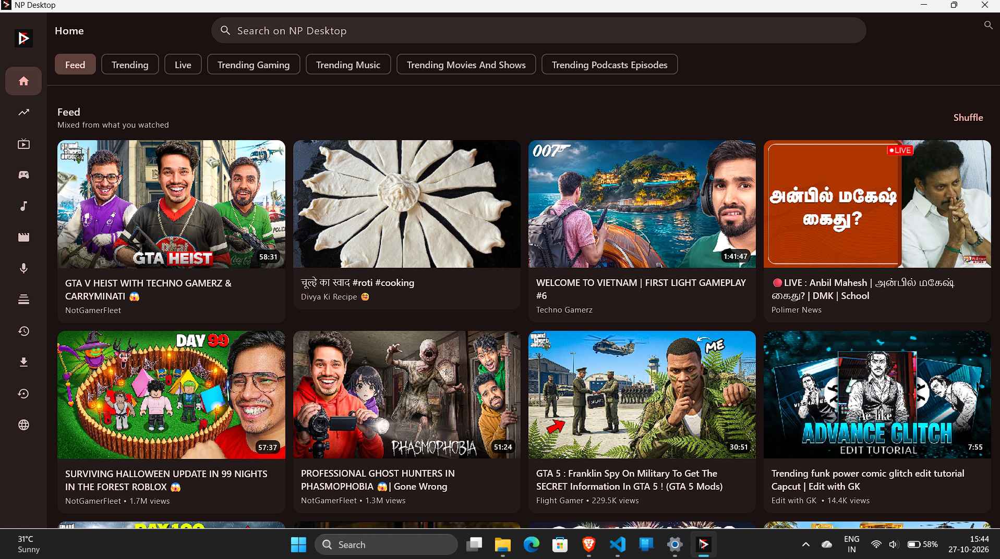
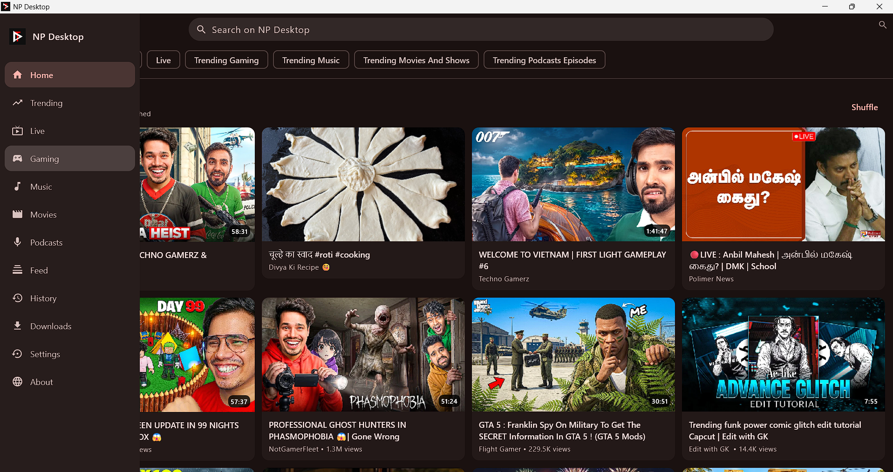
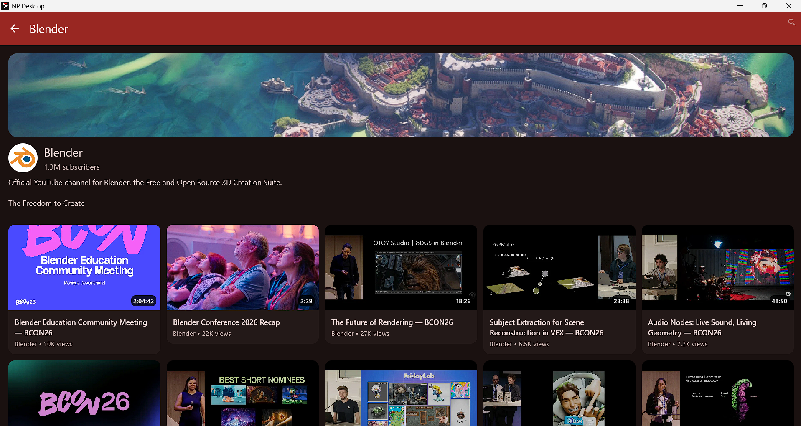
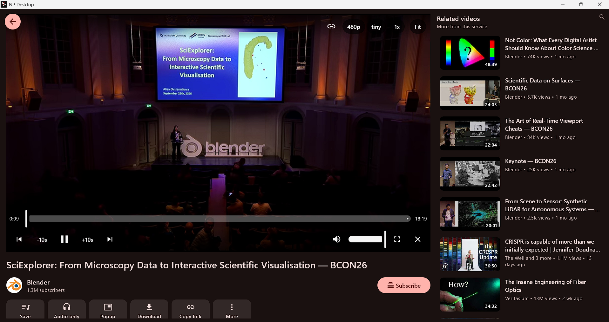
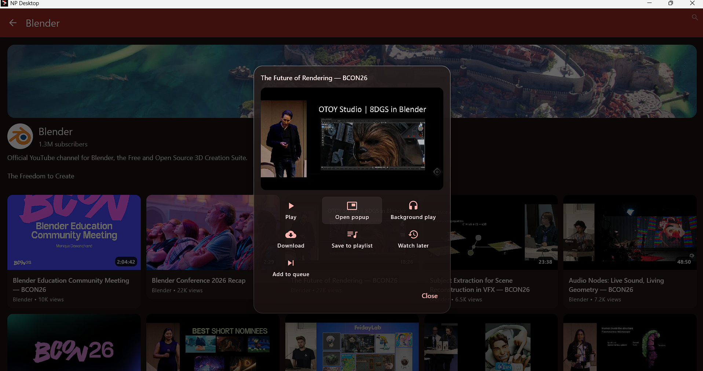
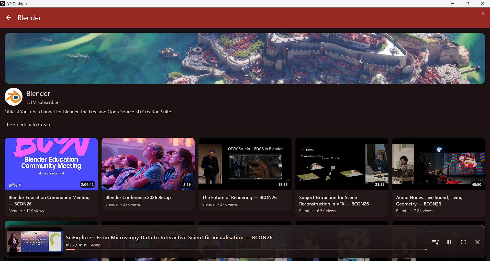
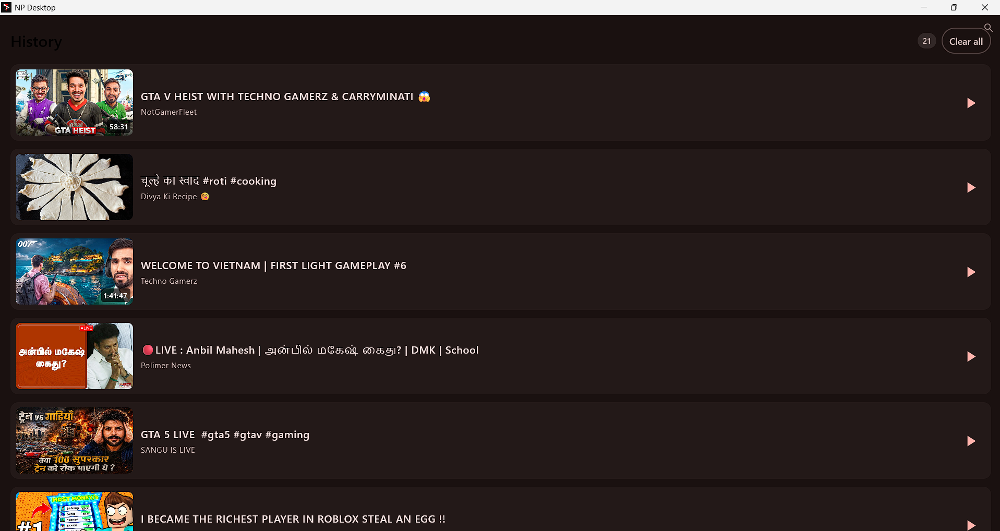

# NP Desktop

<p align="center">
  
</p>

<h3 align="center">A modern, rebuilt fork of <a href="https://github.com/TeamNewPipe/NewPipe">NewPipe</a> for Windows Desktop and Android TV</h3>

<p align="center">
  <a href="https://github.com/Tauseef666-ctrl/NP-Desktop/releases"></a>
  <a href="LICENSE"></a>
</p>

<p align="center">
  
</p>

## About

**NP Desktop** is a personal rebuild of NewPipe with a heavy focus on a proper Windows desktop experience, alongside continued support for Android TV and Android. The goal is to bring a cleaner, more app-like feel to the desktop with proper windowing, keyboard shortcuts, navigation, and media controls while keeping the spirit of NewPipe intact.

> This project is not affiliated with, endorsed by, or connected to the official NewPipe team. All credit for the original idea, extractor, and core goes to the [NewPipe](https://github.com/TeamNewPipe/NewPipe) project and its contributors.

## Platforms

- **Windows Desktop (x64)** – Primary focus. Built with Kotlin Multiplatform + Compose Desktop
- **Android TV** – Optimized for D-pad/remote navigation
- **Android Phone/Tablet** – Kept functional for compatibility

## Key Features

- **Windows Desktop UI** – Custom modern shell, side rail navigation, resizable window, proper fullscreen/immersive modes
- **Keyboard Shortcuts** – YouTube-like shortcuts for playback, volume, captions, speed, seeking and more
- **Web Session Sign-in** – Optional in-app browser sign-in unlocks your YouTube subscriptions and account feed
- **Right-click Everywhere** – A single glass context menu covers feeds, search results, channel pages, history, playlists and the player
- **Queue & Watch Later** – Add anything to the queue or watch later from any surface, with a miniplayer to keep watching while browsing
- **Miniplayer / Picture-in-Picture style popup** – Keep watching while browsing
- **Live Streams** – Live HLS playback that just works, including news channels
- **Fast Startup** – The window appears in about a second; VLC spins up lazily on first playback
- **Downloads** – Built-in download UI for supported streams
- **History & Subscriptions** – Local history, subscription management, and personalized home feed
- **Kiosk Sections** – Feed, Trending, Live, Gaming, Music, Movies & Shows, Podcasts
- **Multi-service support** – YouTube, SoundCloud, PeerTube, Bandcamp, media.ccc.de
- **Local-first** – No forced account login. Subscriptions, history and preferences stay local by default

## Screenshots

| Home Feed | Navigation Drawer |
| --- | --- |
|  |  |

| Channel Page | Player |
| --- | --- |
|  |  |

| Glass Context Menu | Miniplayer |
| --- | --- |
|  |  |

| History | |
| --- | --- |
|  | |

## Supported Services

- [YouTube](https://www.youtube.com/) & [YouTube Music](https://music.youtube.com/)
- [PeerTube](https://joinpeertube.org/) (and all instances)
- [Bandcamp](https://bandcamp.com/)
- [SoundCloud](https://soundcloud.com/)
- [media.ccc.de](https://media.ccc.de/)

## Download

Head over to the [Releases](https://github.com/Tauseef666-ctrl/NP-Desktop/releases) page to download the latest Windows installer (`.msi` or `.exe`) or Android TV/Phone APK. SHA-256 checksums are published alongside each release.

## Building From Source

### Prerequisites
- JDK 21
- Android SDK (for Android builds)
- Git

### Windows Desktop
```bash
./gradlew.bat :desktopApp:packageReleaseMsi :desktopApp:packageReleaseExe
```
The built installers will be available under `desktopApp/build/compose/binaries/main-release/` (`msi/` and `exe/`). For a quick local run without packaging:

```bash
./gradlew.bat :desktopApp:createDistributable
```

### Android / Android TV
```bash
./gradlew.bat assembleRelease
```

## License

This project is licensed under the **GNU General Public License v3.0 or later**. See [LICENSE](LICENSE) for more details.

## Credits

- [NewPipe](https://github.com/TeamNewPipe/NewPipe) - Original project and NewPipeExtractor
- [NewPipeExtractor](https://github.com/TeamNewPipe/NewPipeExtractor) - The backbone for fetching content from supported services
- All upstream contributors who made this possible

## Disclaimer

Using third-party clients may be against the Terms of Service of some platforms. Use at your own discretion and in compliance with your local laws.
