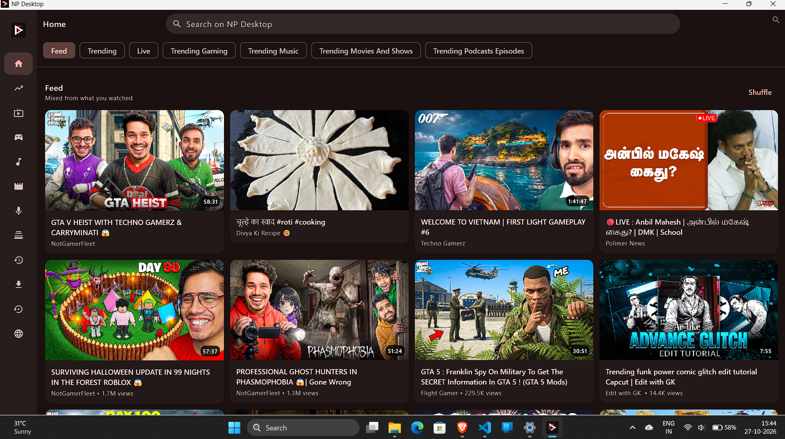
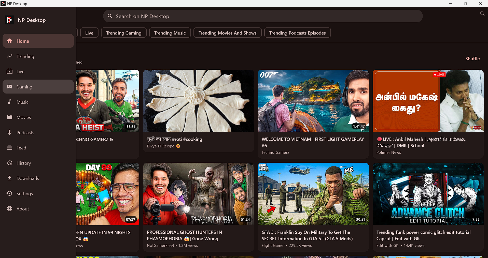
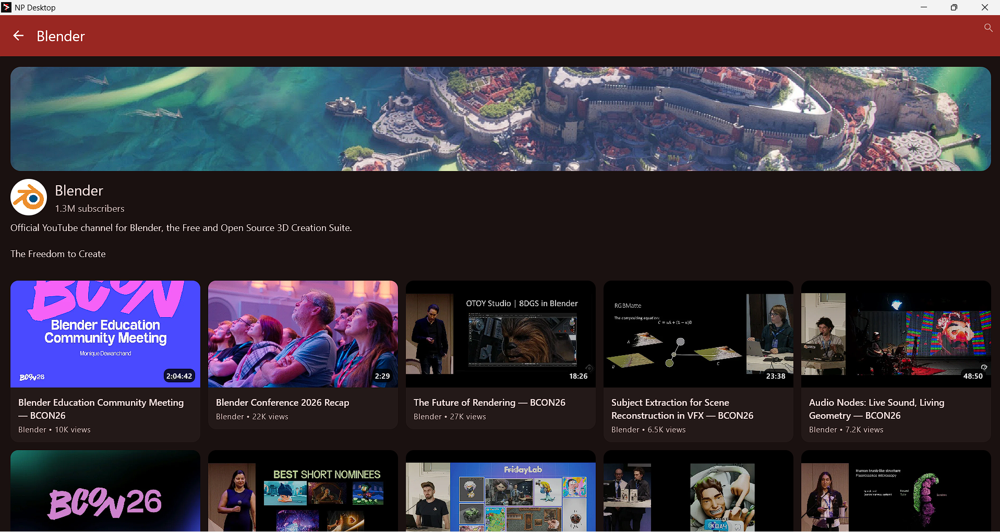
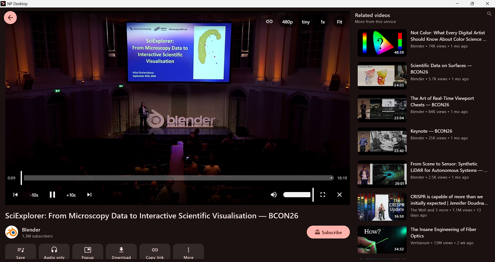
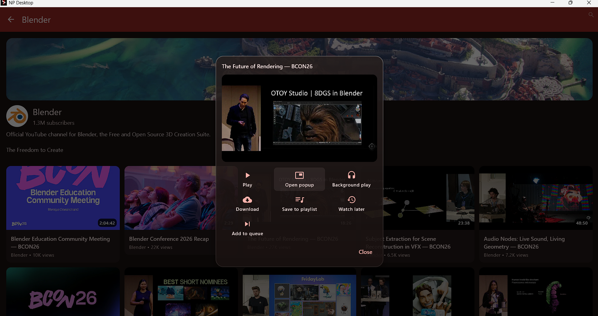
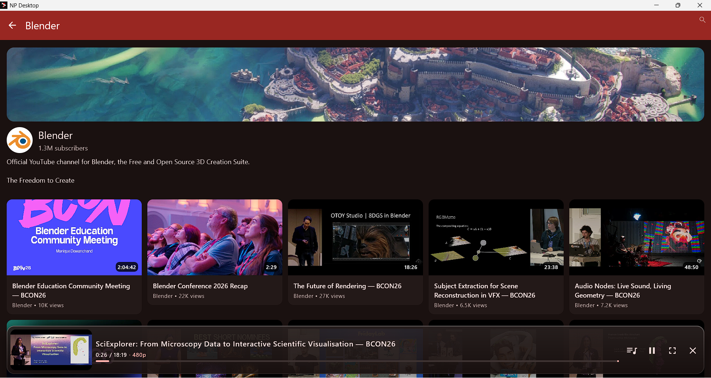
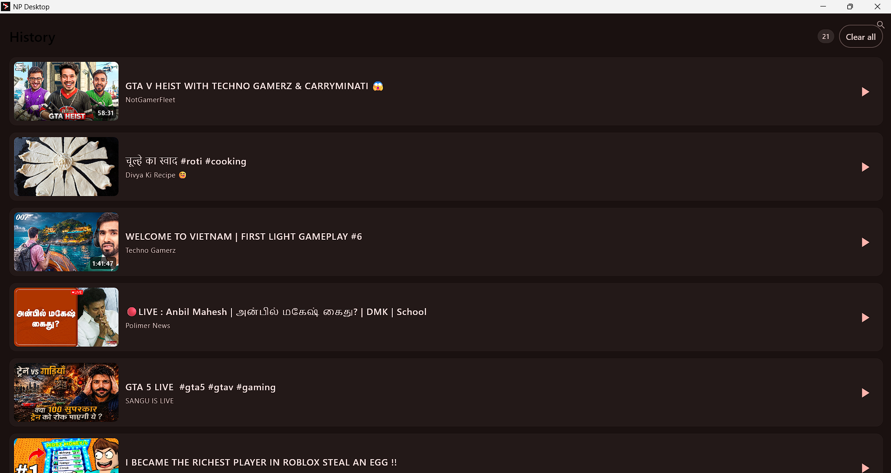

# NP Desktop

<p align="center">
  
</p>

<h3 align="center">A free and open-source streaming client for Windows, Linux, and Android TV</h3>

<p align="center">
  <a href="https://github.com/Tauseef666-ctrl/NP-Desktop/releases"></a>
  <a href="LICENSE"></a>
  
</p>

<p align="center">
  
</p>

## What is NP Desktop?

**NP Desktop** is a free, libre, lightweight streaming client for Windows and Android TV, built as a rebuilt fork of [NewPipe](https://github.com/TeamNewPipe/NewPipe). It plays video and audio from YouTube and other supported services without ads, without tracking, and without requiring a Google account — your subscriptions, history, and preferences stay on your own machine. The desktop experience is built with Kotlin Multiplatform and Compose Desktop, with playback handled by libVLC/VLCJ and content extraction handled by a fork of NewPipe-Extractor ([PipePipeExtractor](https://github.com/TeamNewPipe/NewPipeExtractor)).

> This project is not affiliated with, endorsed by, or connected to the official NewPipe team. All credit for the original idea, extractor, and core goes to the [NewPipe](https://github.com/TeamNewPipe/NewPipe) project and its contributors.

## Key Features

- **YouTube video and audio playback** — quality ladder including 1080p+, audio-only listening, and made-for-kids videos (via a local SABR relay)
- **Search, trending, and subscriptions feeds** — with kiosk sections (Feed, Trending, Live, Gaming, Music, Movies & Shows, Podcasts)
- **Downloads** — built-in download options UI: muxed or adaptive streams, with quality and format choice
- **Glassmorphism UI** — modern desktop shell with side rail navigation, resizable window, and a unified context menu across feeds, search results, channel pages, history, playlists, and the player
- **Windows and Android TV form factors** — proper windowing and keyboard shortcuts on desktop; D-pad/remote navigation on TV
- **Fullscreen player** — toggle with `F` or `F11`; mini-player to keep watching while browsing; media key support
- **Watch history and session caching** — local history and fast startup with lazy VLC initialization
- **Multi-service support** — YouTube, YouTube Music, SoundCloud, PeerTube, Bandcamp, media.ccc.de
- **Local-first** — no forced account login. Subscriptions, history, and preferences stay local by default

Full keyboard reference: [doc/KEYBOARD-SHORTCUTS.md](doc/KEYBOARD-SHORTCUTS.md)

## Architecture

NP Desktop is a Kotlin Multiplatform project: one shared core drives every platform, and each form factor gets a native shell.

| Layer | Technology | What it does |
| --- | --- | --- |
| `shared/` | Kotlin Multiplatform, Compose Multiplatform, Coroutines & Flows | Screens, view models, repositories, the playback engine, and the SABR media relay — everything that is platform-agnostic |
| `desktopApp/` | Compose Desktop, libVLC via VLCJ, jpackage/jdeb | Windows and Linux windowing, keyboard shortcuts, installer packaging |
| `androidApp/` | Compose Android, D-pad focus engine | Phone and Android TV shells with remote-control navigation |
| Extraction | PipePipeExtractor fork | Stream, search, and metadata extraction, including YouTube's SABR session protocol |

The playback stack, end to end:

```
Compose UI → PlaybackController → libVLC (VLCJ)
                    ↓
        SabrMediaServer (in-process HTTP relay, 127.0.0.1)
                    ↓
        YouTube SABR/UMP session (PipePipeExtractor)
```

## Engineering Highlights

A few of the problems this project solves that go beyond wrapping a media player:

- **Bridging YouTube's SABR streaming protocol to libVLC.** Modern YouTube serves media over the SABR/UMP protobuf protocol, which no desktop player speaks. NP Desktop runs an in-process HTTP relay (`SabrMediaServer`) that drives SABR sessions, splices initialization segments and media chunks into a progressive stream, and serves it to libVLC on loopback — with byte-range serving, response pre-buffering so the player never sees a session's slow start, and a dedicated per-track thread pool.
- **Surviving media-generation handovers.** SABR media generations expire every minute or two mid-video. The player detects the end of a generation, reconnects, and carries the playback position *inside the relay URL*, so the fresh session serves media starting at that exact time server-side — libVLC never has to seek, which its prefetch stream filter cannot do reliably on a generated stream.
- **A frame-based playback watchdog.** Wall-clock timers lie: a stream can report `playing` while showing a black screen forever. The watchdog treats freshly decoded frames as the only real progress signal, uses differentiated time windows for relay, walled, and direct streams, runs an unkillable ticker coroutine, and rescues stuck playback into a muxed fallback instead of leaving a dead screen.
- **Honest quality fallback under YouTube's bot wall.** When YouTube blocks a stream route (`attestation required` sessions), the app records the wall per video, switches instantly to the best muxed fallback, greys out blocked quality entries until a retry window expires — and never marks the quality that is actually playing as unavailable.
- **Secure self-updating.** Release assets are verified by SHA-256 digest against a published checksum file, and the updater only accepts files on an explicit asset allowlist.
- **Performance work.** Lazy VLC initialization for fast startup, a tuned Home-feed pipeline with extraction performance tracing (`YT_PERF`), and dedicated bounded thread pools for relay and extraction work.

<!--
  Screenshot placeholder — add your launch screenshots here.

  <p align="center">
    
  </p>
-->

## Screenshots

| Home Feed | Navigation Drawer |
| --- | --- |
|  |  |

| Channel Page | Player |
| --- | --- |
|  |  |

| Glass Context Menu | Miniplayer |
| --- | --- |
|  |  |

| History | |
| --- | --- |
|  | |

## Supported Services

- [YouTube](https://www.youtube.com/) & [YouTube Music](https://music.youtube.com/)
- [PeerTube](https://joinpeertube.org/) (and all instances)
- [Bandcamp](https://bandcamp.com/)
- [SoundCloud](https://soundcloud.com/)
- [media.ccc.de](https://media.ccc.de/)

## Installation

Download the latest installer from the [Releases](https://github.com/Tauseef666-ctrl/NP-Desktop/releases) page — `.msi` for Windows, `.deb` for Debian/Ubuntu, or an Android APK. SHA-256 checksums are published alongside each release.

Step-by-step instructions, including how to handle the Windows SmartScreen warning for unsigned installers, are in [INSTALL.md](INSTALL.md).

## Building From Source

### Prerequisites

- JDK 21
- Git
- Android SDK (for Android builds only)

### Clone

```bash
git clone https://github.com/Tauseef666-ctrl/NP-Desktop.git
cd NP-Desktop
```

### Windows Desktop

```bash
gradlew.bat --no-configuration-cache :desktopApp:packageMsi
```

The installer is written to `desktopApp/build/compose/binaries/`. For a quick local run without packaging:

```bash
gradlew.bat --no-configuration-cache :desktopApp:createDistributable
```

### Linux (Debian/Ubuntu)

```bash
./gradlew --no-configuration-cache :desktopApp:packageDeb
```

The package is written to `desktopApp/build/compose/binaries/`.

### Android / Android TV

```bash
./gradlew assembleRelease
```

## Contributing

Contributions are very welcome! The [CONTRIBUTING.md](CONTRIBUTING.md) guide covers:

- the project architecture and which module to change for which target
- how to build and run the desktop app, Android app and installers
- code style, design tokens and the PR/issue workflow

Start with `good first issue` labeled issues if you are new.

## License

This project is licensed under the **GNU General Public License v3.0 or later** (GPL-3.0-or-later). See [LICENSE](LICENSE) for details. SPDX headers in the source follow the [REUSE](https://reuse.software/) convention and credit NewPipe e.V.

## Security

See [SECURITY.md](SECURITY.md) for the security policy, how to report vulnerabilities, and a statement on how the app handles data.

## Credits

- **[Tauseef Khan](https://github.com/Tauseef666-ctrl)** — author of the Windows desktop, Linux and Android TV builds of NP Desktop, and its UI polish
- [NewPipe](https://github.com/TeamNewPipe/NewPipe) — original project and NewPipeExtractor
- [PipePipeExtractor](https://github.com/TeamNewPipe/NewPipeExtractor) — content extraction layer used by this fork
- All upstream contributors who made this possible

## Disclaimer

NP Desktop is not affiliated with, endorsed by, or connected to YouTube, Google, or any of the supported streaming platforms. It does not include advertising and does not require an account. Third-party clients may be against the Terms of Service of some platforms; you are responsible for using this app in compliance with those terms and your local laws.
